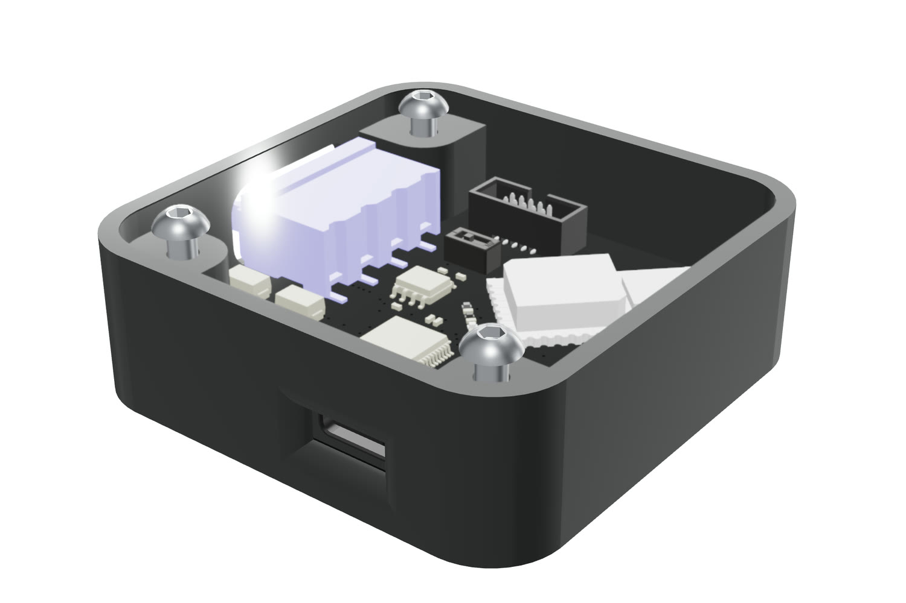

# opentag U1



UWB distance and indoor positioning hardware for robots: KiCad design, Rust
firmware, host tools, enclosure CAD and bench test notes. Everything in this
repository is released under the [MIT License](LICENSE).

Product page and kits: <https://open-tags.com/products/u1/> ·
Documentation: <https://open-tags.com/docs/> ·
Measured performance: <https://open-tags.com/validation/>

## Contents

| Folder | What it holds |
| --- | --- |
| [`hardware/`](hardware/) | KiCad project for U1 PCB V2.2 (4 layers, STM32G474 + Qorvo DWM3000), schematic PDF, part list, and fabrication outputs (Gerbers + drill) |
| [`firmware/stm32g4/`](firmware/stm32g4/) | Embassy (Rust) firmware: two-way ranging, TDOA anchor/tag, USB serial, CAN FD, and board bring-up examples |
| [`firmware/twr_plot/`](firmware/twr_plot/) | Host-side plotting, localization, and calibration tools (Rust) |
| [`mechanical/`](mechanical/) | Enclosure STEP files (assembly, case, lid) and a printable case `.3mf`; also on [Onshape](https://cad.onshape.com/documents/432dec42a257744f3b8f22d9/w/829cba9d7a4b997211a6277e/e/23eb042ed87c06c15fa7c407) |
| [`testing/`](testing/) | Bench test notes for two-way ranging and TDOA |

The ROS 2 driver and the Python host scripts live with the website source at
[open-tags/open-tags.github.io](https://github.com/open-tags/open-tags.github.io)
(`ros2/` and `docs/scripts/`).

## Hardware

Open `hardware/opentag.kicad_pro` in KiCad 10. Footprints are embedded in the
board file. Three vendor 3D models are not redistributed here, so they appear
missing in the 3D viewer until you add them to `hardware/footprints/`:

- `1473790000--3DModel-STEP-764301.STEP`: Weidmüller 1473790000 terminal block (from Weidmüller)
- `3220-10-0300-00 3D.stp`: CNC Tech 3220-10-0300-00 SWD header (from CNC Tech)
- `v2 - dip_switch.step`: DIP switch body

`hardware/fabrication/` was generated from the board file with `kicad-cli`.

## Firmware

Requires Rust with the `thumbv7em-none-eabi` target and
[probe-rs](https://probe.rs) with an ST-Link or other SWD probe.

```sh
rustup target add thumbv7em-none-eabi
cd firmware/stm32g4
cargo run --release --bin twr_resp    # build, flash, and stream defmt logs
```

`tdoa_bench` needs `TDOA_ROLE=master` or `TDOA_ROLE=anchor` at build time.
Cargo fetches Embassy from GitHub at a pinned commit. See
[`firmware/README.md`](firmware/README.md) for the binaries, pinout, and
flashing, and [`firmware/RANGE_CAN.md`](firmware/RANGE_CAN.md) for the
range-over-CAN build.

## Third-party code

Several bring-up examples in `firmware/stm32g4/src/bin/` are adapted from the
[Embassy](https://github.com/embassy-rs/embassy) STM32G4 examples (MIT OR
Apache-2.0). Dependencies keep their own licenses; see each crate on crates.io.
